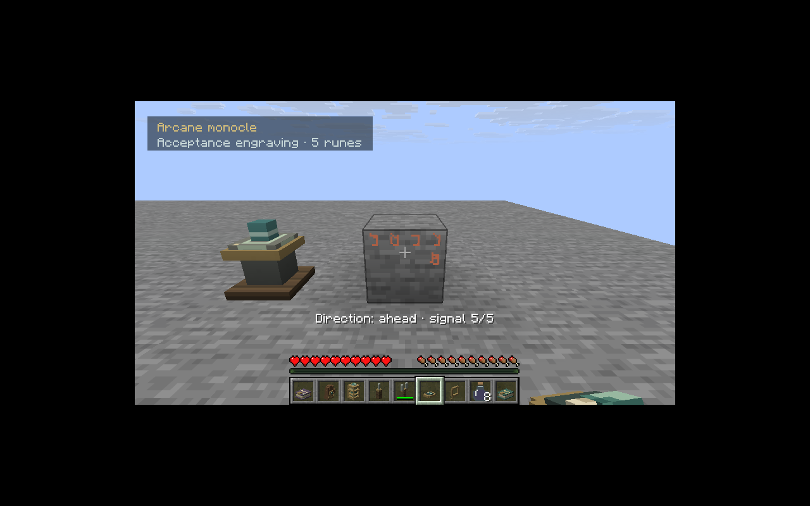
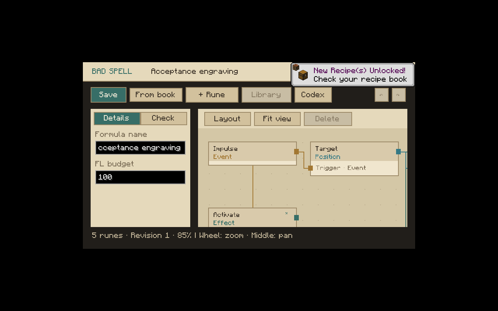
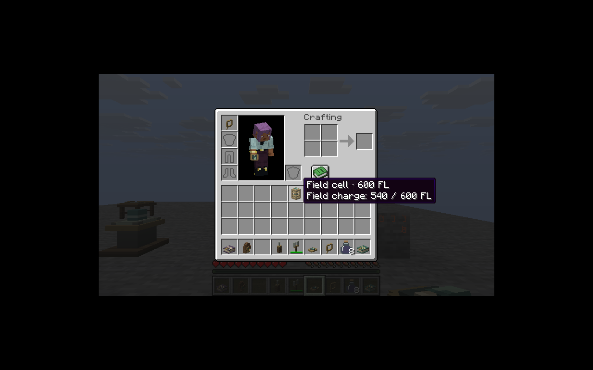

# M1 – Abschluss und Abnahme

**Status: abgeschlossen am 24.10.2026.** M1 bezeichnet die spielbare Runen-/Werkzeuggrundlage einschließlich der sechs zuletzt offenen Punkte. Es bedeutet nicht Abschluss der gesamten PDF-Mod.

| Teilmeilenstein | Ergebnis | Nachweis |
|---|---|---|
| M1.1 Runensprache und tragbare Werkzeuge | Typisierte Graphen, Module/Bedingungen/Bündel, zuverlässige Ziele, Qualitätsstufen, Meißel, Gabel, Monokel, Kompass, Tinte/Platten/Buch | Kern- und Serverprüfungen; echte Netzwerkbedienung |
| M1.2 Feldkristall | Gerichtete bedarfsgesteuerte Leitung ohne Speicher/Erzeugung; Besitzer, Richtung, Pfadlänge und Rate begrenzt | Verbrauch/Gutschrift exakt erhalten; Gegenrichtung, Fremdzugriff und unterbrochener Pfad getestet |
| M1.3 Runenhalter | Gemeinsamer Effektadapter, Flächen und Bündel, Offlinebesitzer, persistierte Verzögerung/Intervalle, Start/Stop und Redstone | Geräte-GameTests und echter Serverneustart |
| M1.4 Herstellung | Alle sieben Stationen; keine vorgegebenen Mod-Zwischenprodukte | 848 tatsächliche Rezeptschritte, alle 18 Ziele; endlicher Materialplan unabhängig nachgerechnet |
| M1.5 Oberfläche/Assets | Kodex, Typsuche, Portwahl, eigene Stationsbereiche; überarbeitete Bücher, Handschuhe, Zellen, Werkzeuge/Optiken | Zwei echte Clients; keine fehlenden Itemmodelle/Atlasfehler in der korrigierten JAR |
| M1.6 Multiplayer/Persistenz | Zwei echte Clients, serverseitige Rechte, Buchrevision/Handschuh-Slot über Netzwerk, Fremdzugriff abgewiesen | Phase-1-/Phase-2-Protokolle und Abnahmejournal |
| M1.7 Neustart | Handschuh-Snapshot und aktiver Slot, Geräteauftrag, physisches Runenfeld und bezahltes Feld bleiben erhalten | Nach sauberem Serverstopp erneut geladen und geprüft |
| M1.8 Dokumentation/Artefakt | Aktuelle 161-Punkte-Tabelle, reproduzierbare Tests, JAR und SHA-256 | README, TESTING, IMPLEMENTATION_STATUS, Release-Verzeichnis |

## Tatsächliche Ergebnisse

- **45 Kernprüfungen und 49 erforderliche Server-GameTests bestanden.**
- **848 tatsächliche Crafting-/Verarbeitungsschritte**, sieben platzierte Stationen und 18 erhaltene Endprodukte.
- Gewonnene Mod-Rohstoffe: Runenholz, Feldkristalle, Arkanerz, Mondblüten und Resonanzsplitter aus echten Survival-Abbauvorgängen an kontrollierten Testblöcken. Vanilla-Komponenten und Werkzeuge wurden als Testbasis bereitgestellt. Alle Bad-Spell-Zwischenprodukte entstehen durch Rezepte.
- Zwei tatsächliche Minecraft-Clients namens `BadSpellQA1`/`BadSpellQA2` mit Mod-JAR im jeweiligen `mods`-Ordner; keine simulierten Spieler für diesen Netzwerktest.
- Echte Client-Buchspeicherung, Export in einen Q3-Handschuh und Slotwechsel über Umschalt+Mausrad; nach Neustart Snapshot und Slot identisch.
- Der zweite Spieler erhält beim fremden Runenhalter eine Ablehnung. Der Besitzer kann physische Schrift öffnen, über die Gabel aktivieren und per Monokel untersuchen. Der Feldkompass wurde im Client an einen Ort gebunden und geortet.
- Bereits bezahlte Felder behalten ihre absolute Ablaufzeit; Neustart verlängert sie nicht künstlich. Der Feld-Nachweis wird unmittelbar nach dem Laden vorgenommen, damit ein kurzer Rest nicht vor der Messung abläuft.

## Reproduktion

JDK 25 und die im README festgelegten Versionen verwenden.

```bash
./gradlew build runGameTestServer
python3 scripts/plan-m1-acceptance.py
./gradlew acceptanceClasses prepareServerRun writeAcceptanceClientCommand -PqaM1 -PqaPhase=1
./gradlew runServer -PqaM1 -PqaPhase=1
```

Der dedizierte Testserver liegt unter `run/m1-acceptance-server`. Er benötigt `eula=true` und eine lokale Testkonfiguration auf Port 25576 mit `online-mode=false`, `enforce-secure-profile=false`, Survival-Modus und Spawn-Schutz 0. Testclients und QA-Besitzernamen verwenden die im Akzeptanz-Launcher festgelegten Offline-Profile. Eine flache Testwelt genügt; Ressourcenfixtures werden explizit erzeugt. Die Akzeptanzklassen unter `src/acceptance` sind **nicht** in der Mod-JAR enthalten.

In einer zweiten Konsole mit funktionierendem grafischen Display:

```bash
python3 scripts/acceptance/launch-clients.py
```

Nach dem Materiallauf das persönliche Formelbuch öffnen, eine Revision speichern, an den Handschuh exportieren und dessen belegten Slot wechseln. Das Journal `acceptance.properties` dokumentiert die tatsächlichen Serverereignisse. Für die im Protokoll ausgeführten zusätzlichen Client-/OP-Handgriffe wurde ausschließlich Testausrüstung verwendet; sie gehört nicht zum Materiallauf.

Server sauber stoppen und dieselbe Welt erneut starten:

```bash
./gradlew runServer -PqaM1 -PqaPhase=2
```

Beide Clients erneut verbinden. Das Journal muss `survival_material_journey`, `network_book_save`, `two_real_clients_phase1`, `two_real_clients_phase2`, `restart_paid_field`, `restart_holder_and_board` und `restart_player` mit `PASS` enthalten. Für einen vollständigen neuen Phase-1-Lauf ein frisches Testverzeichnis verwenden; ein vorhandenes abgeschlossenes Journal wird nicht als neuer Materiallauf ausgegeben.

## Grenzen der Aussage

Geprüft wurden die festgelegte Plattform und eine lokale Offline-Verbindung. Online-Authentifizierung, Internetlatenz, sämtliche Auflösungen und Drittmodkombinationen sind nicht Teil dieser Abnahme. Natürliche Weltverteilung und die noch offenen PDF-Systeme bleiben nachfolgenden Meilensteinen zugeordnet.

## Clientbelege







[Build und GameTests](M1_CLOSURE_VALIDATION.log) · [Dedizierte Abnahme](M1_ACCEPTANCE_EVENTS.log) · [Persistenzjournal](M1_ACCEPTANCE.properties)
