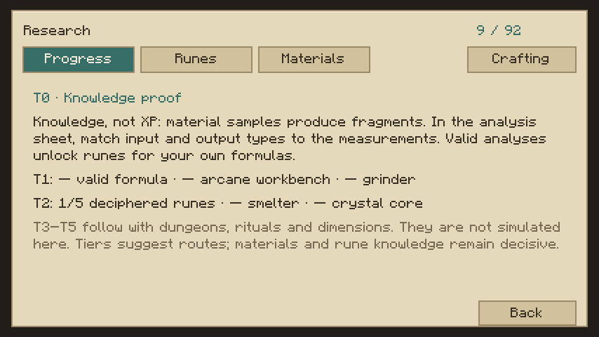
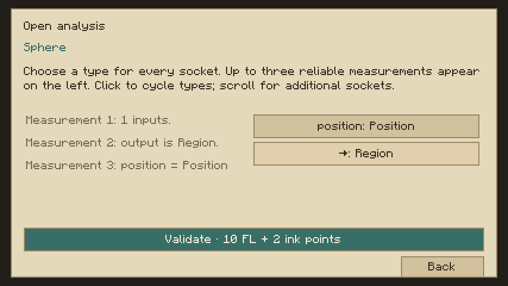
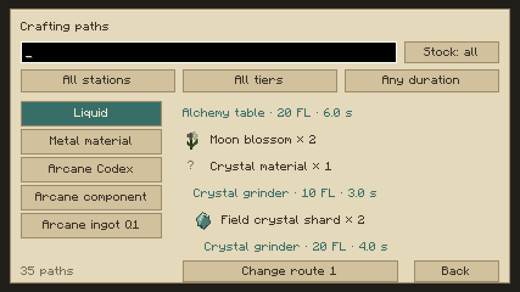

# M2 – Forschung und Spielfortschritt: Abnahme

Abgeschlossen am 24.10.2026 auf Minecraft 26.2, NeoForge 26.2.0.93 und Java 25. M2 meint den in der Unterhaltung vereinbarten Forschungsmeilenstein. Die PDF-Roadmap verwendet eine andere Nummerierung. Alle 161 Konzepte bleiben einzeln in IMPLEMENTATION_STATUS.md dokumentiert.

| Zwischenmeilenstein | Umsetzung und Prüfung |
|---|---|
| M2.1 Wissensdaten | Versionierte persönliche Runenkenntnis, getrennte Entdeckungen/Nachweise, Tod-Clone und einmalige M1-Migration einschließlich inaktiver Handschuh-Slots. GameTests und echte Spielerdateien. |
| M2.2 Entschlüsselung | Reale Materialprobe + Papier → weltgebundenes Fragment. Stabile Porttypen, bis zu drei sichere Hinweise, 5–30 FL und 1–4 Schreibpunkte; keine Zufalls-/XP-Freischaltung. Im echten Client bedient. |
| M2.3 Freischaltungen | Bekannte Runen begrenzen freie Buchformeln, Vorlagen, Export, Plattenimport, physische Gravur und persönliches Wirken. Eingebettete Module werden rekursiv geprüft. Alle 91 vorhandenen Operatoren plus Modulaufruf erreichbar. |
| M2.4 Weitergabe | Bewusst verfasstes Lehrblatt mit realen Kosten. Zweiter Client trägt es ohne Wissensgewinn; erst Benutzen lehrt die Rune und verbraucht das Blatt. |
| M2.5 Fortschrittsanzeige | T0–T2 als Nachweise, keine Skilltree-XP. T3–T5 bleiben an ihre tatsächlichen späteren Systeme gebunden. Übersicht und Entdeckungen im Kodex erreichbar. |
| M2.6 Handwerkswege | 68 echte Rezepte, Entdeckungsmaskierung, Mengenskalierung, Nebenprodukte, Alternativrouten, Station/T-Stufe/Dauer und Material-/Vorratsfilter. Build prüft die Guide-Daten gegen die Quelldateien. |
| M2.7 Integration | 51 Kernprüfungen und 61 erforderliche Server-GameTests erfolgreich. Zwei tatsächliche Clients mit Mod-JAR, privates Wissen und echter Tod/Respawn. |
| M2.8 Persistenz/Artefakt | Sauberer Serverstopp und Wiederverbindung beider Clients: bekannte und entschlüsselte Runen sowie Stationsnachweise stimmen exakt mit den gespeicherten Profilen überein. JAR und Prüfsumme liegen im Release-Verzeichnis. |

## Tatsächlicher Netzwerktest

Neue Survival-Spieler `M2Research1` und `M2Research2` beginnen mit je acht Grundlagen. Der erste Spieler bereitet über die Oberfläche ein Kreisfragment vor, stellt die Porttypen korrekt ein und bezahlt den Prüflauf: neun bekannte Runen. Der zweite Spieler bleibt zunächst bei acht. Der erste Spieler schreibt ein Lehrblatt. Nach Aufnahme bleibt der zweite Spieler bei acht; nach bewusstem Rechtsklick steigt er auf neun. Die Spielerprofile bleiben getrennt und benötigen keine gemeinsame Gruppe.

Die Testbasis besteht aus bereitgestellten vorhandenen Materialien, Formelbüchern und Zellen; es ist kein erneuter vollständiger Survival-Herstellungslauf. Zur Übergabe wurde das tatsächliche gedroppte Lehrblatt im lokalen QA-Aufbau an den Empfänger versetzt. Es wurde kein Wissen per Adminbefehl vergeben. Der erste Spieler starb und respawnte; die neun Runen blieben erhalten. Ein weiterer kontrollierter Tod bestätigt das auch im serverseitigen QA-Journal.

Vor dem folgenden Serverneustart wurden die tatsächlichen Mengen bekannter/entschlüsselter Runen und Stationsnachweise protokolliert. Nach dem Neustart prüfen beide Logins diese Daten exakt, bevor weitere Forschung erfolgt. Beide Prüfungen sind PASS. Die QA-Klassen befinden sich ausschließlich in `src/acceptance` und sind nicht Bestandteil der verteilten JAR.

Nachweise: [Build und Tests](M2_VALIDATION.log), [Netzwerkereignisse](M2_ACCEPTANCE_EVENTS.log), [Journal](M2_ACCEPTANCE.properties). Bedienung: [FORSCHUNG.md](FORSCHUNG.md).

## Reproduzieren

```bash
python3 scripts/generate-m2-assets.py
./gradlew build runGameTestServer
./gradlew acceptanceClasses prepareServerRun writeAcceptanceClientCommand -PqaM2 -PqaPhase=1
./gradlew runServer -PqaM2 -PqaPhase=1
```

In `run/m2-acceptance-server` EULA und lokalen Testserver einrichten: Survival, `online-mode=false`, `enforce-secure-profile=false`, Port 25577, IP 127.0.0.1. Der Harness legt eine Testplattform und endliche Material-/Werkzeugfixtures für die beiden frischen Spieler an. Er gewährt keine Forschungsrunen. Mit funktionierendem Display:

```bash
BAD_SPELL_QA_RUN=m2-client BAD_SPELL_QA_NAME=M2Research BAD_SPELL_QA_PORT=25577 \
  python3 scripts/acceptance/launch-clients.py
```

Die beschriebenen Forschungsschritte tatsächlich in den Clients bedienen. Vor dem Stopp müssen beide Spieler online sein, damit der Harness ihre Wissensnachweise protokollieren kann. Danach denselben Server mit `-PqaM2 -PqaPhase=2` starten und beide Clients neu verbinden. Für einen neuen vollständigen Versuch ein frisches Testverzeichnis verwenden.

## Abgrenzung

Die Prüfung lief lokal mit Software-Rendering, zwei getrennten Offline-Clients und GUI-Skalierung 2. Online-Authentifizierung, beliebige Auflösungen und Drittmodkombinationen sind nicht abgenommen. Die Handwerksanzeige prüft mitgeführte Zutaten/FL, keine weltweite Zugänglichkeit oder Reservierung aller Maschinen. Natürliche neue Fundstrukturen, NPC-Unterricht, Einmal-Schriftrollen und T3–T5-Inhalte gehören zu den kommenden Welt-/Ritual-/NPC-Meilensteinen. Allgemeine Fehlerbereinigung bleibt wie gewünscht für später vorgesehen.

## Bilder aus dem tatsächlichen Client






