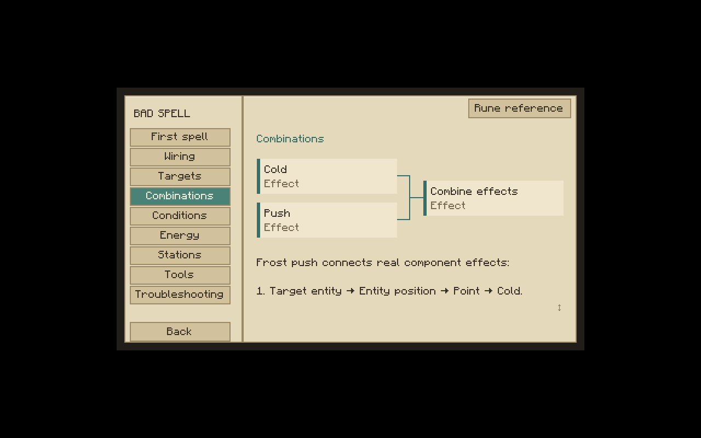
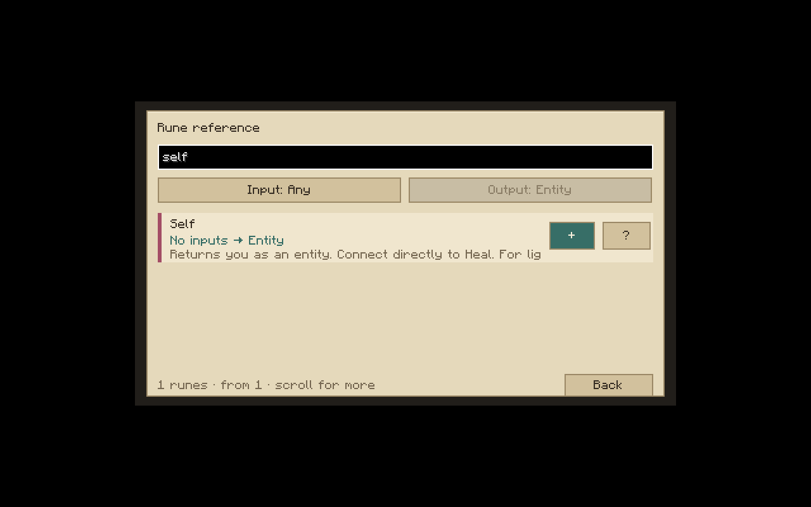

# Bedienungsüberarbeitung: Runenwerkstatt und Kodex

Die neue Oberfläche verwendet eine gemeinsame Gestaltung aus Pergament, dunkler Schrift, Messing und gedecktem Jadegrün. Stationsmodelle und Werkzeuge verwenden dieselben eigenen Materialtexturen; alle Stationsmodelle bleiben innerhalb eines Blocks.

## Einstieg

- **G** öffnet den bebilderten Kodex. Alternativ: Arkaner Kodex (Buch + Tintenbeutel + Kupferbarren), oder Kodex im Formeleditor.
- **+ Rune** öffnet ein eigenes Lexikon. Suche durchsucht Namen, Beschreibung, Ports und Datentypen; Eingangs- und Ausgangsfilter arbeiten mit dem echten Runenregister.
- Ein Klick auf eine Eingangszeile bietet nur Quellen mit passendem Ausgang an und verbindet die gewählte neue Rune automatisch. Vorhandene Runen: Ausgang anklicken, dann passenden Eingang. Rechtsklick auf eine Eingangszeile trennt die Verbindung. Esc beendet die Verbindungsauswahl.
- **?** erklärt die gewählte Rune einschließlich Pflichtports, Ausgangstyp und Parametergrenzen. Details lassen sich bei vielen Parametern mit dem Mausrad scrollen.
- Die Bibliothek öffnet eine sichtbare Vorlagenliste statt einer durchzuklickenden Preset-Schaltfläche.
- Beim Halten eines Handschuhs zeigt eine kleine Zielvorschau die erkannte Kreatur. Die Vorschau verwendet dieselbe Erfassungsregel wie der Server; Ausführung und Rechte bleiben serverseitig.

## Ziele und verknüpfte Wirkungen

`Selbst` ist ein **Wesen**, keine Position. `Wesenposition` wandelt es für räumliche Effekte um:

```text
Selbst → Wesenposition → Kreis → Schild → Aktivieren
Impuls ─────────────────────────────────→ Auslöser
```

Heilung akzeptiert Selbst direkt. Bei voller Gesundheit bzw. laufender Regeneration wird mit einer konkreten Erklärung abgelehnt, ohne Energie abzuziehen. Rechtsklick auf eine Kreatur wird mit gehaltenem Handschuh als Zauberaktion verarbeitet, bevor deren normale Interaktion ausgeführt wird; bereits verweigerte Interaktionsereignisse werden respektiert.

Neue echte Kompositionen:

- **Eigenlicht:** Selbst → Wesenposition → Punkt → Licht.
- **Froststoß:** Zielwesen → Wesenposition → Punkt → Kälte, parallel Zielwesen + Blickrichtung → Stoß, beide → Effekte bündeln. Ziel vorhanden + Wenn Effekt verhindert die Auswertung bei fehlendem Ziel.
- **Wachsamer Schutz:** Eigene Gesundheit unter 12? Heilung; sonst Schutzkreis. Nur der gewählte Zweig wird bezahlt.

Bündeln unterstützt bis zu acht flache Kampf-/Licht-/Leereffekte. Kosten werden addiert; alle Teilaktionen werden vorbereitet, bevor Energie oder Weltzustand verändert werden. Doppelte identische Zielwirkungen und Transfers/Bindungen/Siegel in Bündeln werden abgelehnt. Es ist keine zeitliche Sequenz: Verzögerung/Intervall gehört an den gemeinsamen Aktivieren-Auslöser. Alle bisherigen eigenständigen Effekte und Snapshotformeln bleiben lesbar.

## Stationen und Rezepte

Die sieben Stationen haben zur Aufgabe passende Arbeitszonen und Prozessgrafiken; mindestens fünf unterschiedliche Slot-Anordnungen. Container- und Netzwerk-Slotindizes bleiben erhalten, damit Shift-Klick und serverseitige Inventarregeln gleich bleiben. Stationsart und Zellkapazität werden synchronisiert.

Das Stations-**?** zeigt eine Rezeptansicht mit Itembildern, Mengen, FL und Dauer. Die 55 Verarbeitungsrezepte werden aus denselben JSON-Dateien in eine nur lesende Clientanzeige generiert. Besondere Buchgravur/Runenhalter-Aktionen werden im Kodex erklärt; sie sind keine erfundenen JSON-Rezepte. Der Runenhalter verwendet jetzt die gemeinsame Wirkungslogik einschließlich Flächen und kombinierten Effekten; gespeicherte Aufträge überstehen Weltneustarts.

## Grenzen

Der anschließende M1-Abschluss umfasst jetzt auch Geräteausführung und die Mehrspieler-/Neustart-Abnahme. Weitere Weltinhalte und das vollständige Forschungssystem bleiben späteren Meilensteinen zugeordnet. Exakte Validierungsergebnisse und grafisch geprüfte Abläufe stehen in TESTING.md und docs/M1_ACCEPTANCE.md. Beide Seiten benötigen den neuen Build: Netzwerkprotokoll 4.

## Geprüfte Bildschirmansichten





Im grafischen Client wurde Heilung als neuer Knoten eingefügt, dessen Zielzeile angeklickt und Selbst in der automatisch auf Wesen-Ausgänge begrenzten Auswahl gewählt. Die Verbindung wurde erstellt; die Fehlerzahl sank von zwei auf eins. Der verbleibende Fehler war die absichtlich noch nicht an den Hauptausgang angeschlossene neue Teilformel. Der Entwurf wurde verworfen.
